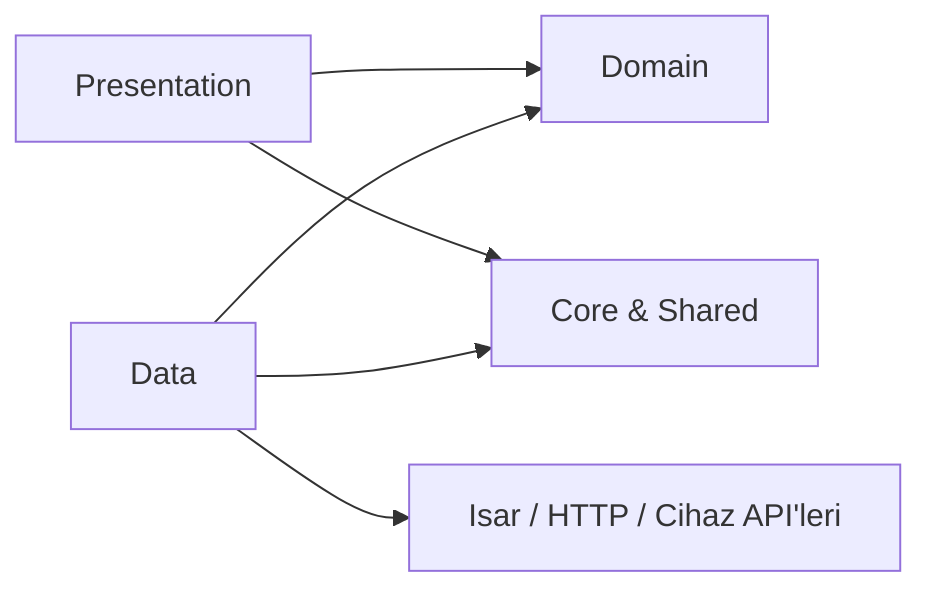
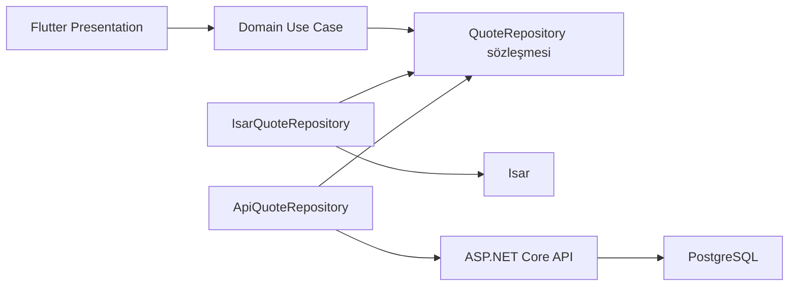
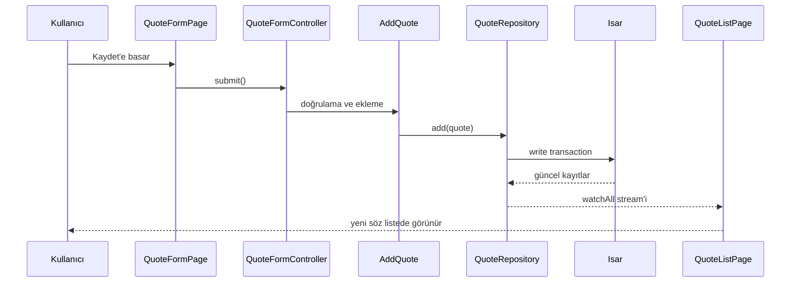

# Quote Reminder — Proje Mimarisi Rehberi

> Bu belge Quote Reminder uygulamasının yaşayan mimari rehberidir. Yeni bir ekran, veri kaynağı veya özellik eklemeden önce ilgili bölümü okuyun. Proje büyüdükçe burada açıklanan kararları da güncelleyin.

## İçindekiler

1. [Amaç ve mimari kararlar](#amaç-ve-mimari-kararlar)
2. [Temel kavramlar](#temel-kavramlar)
3. [Klasör ağacı](#klasör-ağacı)
4. [`core` klasörü](#core-klasörü)
5. [`shared` klasörü](#shared-klasörü)
6. [`features` klasörü](#features-klasörü)
7. [Feature içi katmanlar](#feature-içi-katmanlar)
8. [Bağımlılık kuralları](#bağımlılık-kuralları)
9. [Riverpod yerleşimi](#riverpod-yerleşimi)
10. [Isar yerleşimi](#isar-yerleşimi)
11. [Gelecekte ASP.NET Core entegrasyonu](#gelecekte-aspnet-core-entegrasyonu)
12. [Kod ve isimlendirme kuralları](#kod-ve-isimlendirme-kuralları)
13. [Yeni feature ekleme rehberi](#yeni-feature-ekleme-rehberi)
14. [Uçtan uca Quote örneği](#uçtan-uca-quote-örneği)
15. [Sık yapılan hatalar](#sık-yapılan-hatalar)
16. [Belgeyi güncel tutma](#belgeyi-güncel-tutma)

---

## Amaç ve mimari kararlar

Quote Reminder; kişisel gelişim, psikoloji, motivasyon, şarkı sözü ve benzeri alıntıları cihazda saklayan, kategorilere ayıran ve yerel bildirimlerle hatırlatan **offline-first** bir Flutter uygulamasıdır.

İlk sürümde sunucu, kullanıcı hesabı ve internet zorunluluğu yoktur. Veriler cihazdaki Isar veritabanında tutulur; bildirimler Android cihazın yerel bildirim altyapısıyla planlanır. Bu yaklaşım ilk sürümü küçük, hızlı ve öğrenilebilir tutar.

Proje iki yaklaşımı birlikte kullanır:

- **Feature First:** Kod teknik türüne göre değil, kullanıcıya sunduğu yeteneğe göre gruplanır. Söz ekleme, listeleme, silme ve düzenleme `features/quote` altında yaşar.
- **Clean Architecture’dan ilham alan katmanlama:** Her feature içinde kullanıcı arayüzü, iş kuralları ve veri erişimi ayrılır. Bu katı bir şablon değil; ihtiyaç arttıkça derinleşebilen pragmatik bir yapıdır.

Bu seçimlerin hedefi şudur: bugün Isar kullanan uygulama, yarın ASP.NET Core API ve bulut senkronizasyonu eklendiğinde ekranlarını baştan yazmadan büyüyebilsin.

### Mimari hedefler

- Kullanıcı arayüzü veritabanını veya HTTP ayrıntılarını bilmez.
- İş kuralları Flutter widget’larına bağımlı olmaz.
- Her feature mümkün olduğunca kendi içinde bulunur.
- Ortak kod gerçekten ortaksa `core` veya `shared` içine alınır.
- Klasörler boş dursun diye değil, kod ihtiyacı doğduğunda kullanılır.

---

## Temel kavramlar

### Feature First nedir?

Feature First, uygulamayı `screens`, `models` ve `services` gibi teknik dosya türlerine göre ayırmak yerine ürün özelliklerine göre düzenlemektir.

**Kaçınılacak yapı:**

```text
lib/
├── models/
├── screens/
├── services/
└── widgets/
```

Bu yapı küçükken rahat görünür. Fakat `quote`, `category` ve `settings` büyüdüğünde, aynı özelliğe ait dosyalar farklı klasörlere dağılır.

**Tercih edilen yapı:**

```text
features/
├── quote/
│   ├── data/
│   ├── domain/
│   └── presentation/
└── category/
    ├── data/
    ├── domain/
    └── presentation/
```

Örneğin bir sözün düzenlenmesiyle ilgili dosyayı aradığınızda, ilk bakılacak yer `features/quote` olur.

### Clean Architecture burada ne anlama gelir?

Clean Architecture’ın özü, bağımlılıkların yönünü kontrol etmektir. İçteki iş kuralları dıştaki teknoloji ayrıntılarını bilmez.

```text
Presentation (ekranlar ve etkileşim)
            ↓
Domain (iş kuralları ve sözleşmeler)
            ↓
Data (Isar, HTTP, cihaz API'leri)
```

- **Presentation:** Kullanıcının gördüğü ekranlar, küçük widget’lar ve UI state.
- **Domain:** `Quote` gibi uygulama kavramları, kurallar, use case’ler ve repository sözleşmeleri.
- **Data:** Isar koleksiyonları, veri modelleri, repository uygulamaları ve DTO dönüşümleri.

Bu yapı bir amaç değil, değişimi yönetme aracıdır. Tek satırlık bir ekran için üç katmana zorla dosya eklemek yerine, karmaşıklık arttığında katman kullanın.

---

## Klasör ağacı

```text
lib/
├── core/
│   ├── constants/
│   ├── enums/
│   ├── errors/
│   ├── extensions/
│   ├── services/
│   ├── theme/
│   ├── utils/
│   └── widgets/
├── shared/
│   ├── models/
│   ├── providers/
│   └── widgets/
├── features/
│   ├── home/
│   │   ├── data/
│   │   ├── domain/
│   │   └── presentation/
│   ├── quote/
│   │   ├── data/
│   │   ├── domain/
│   │   └── presentation/
│   ├── category/
│   │   ├── data/
│   │   ├── domain/
│   │   └── presentation/
│   ├── favorites/
│   │   ├── data/
│   │   ├── domain/
│   │   └── presentation/
│   ├── notifications/
│   │   ├── data/
│   │   ├── domain/
│   │   └── presentation/
│   └── settings/
│       ├── data/
│       ├── domain/
│       └── presentation/
└── main.dart
```

> `data`, `domain` ve `presentation` klasörleri başlangıçta boş kalabilir. Gerçek dosya ihtiyacı doğduğunda eklenir; her klasöre yapay dosyalar koymak gerekmez.

---

## `core` klasörü

`core`, uygulamanın her yerinde kullanılabilecek ve belirli bir feature’a ait olmayan altyapı ile kuralları içerir. Bir kod parçası yalnızca Quote ekranında anlamlıysa `core`a değil, `features/quote` içine aittir.

### `core/constants/`

Tekrar kullanılacak, değişken olmayan uygulama değerleri burada tutulur.

**Örnek dosyalar:**

```text
app_constants.dart
app_strings.dart
notification_constants.dart
```

```dart
abstract final class AppConstants {
  static const String appName = 'Quote Reminder';
  static const int maxQuoteLength = 500;
}
```

**Buraya koyun:** uygulama adı, varsayılan limitler, bildirim kanal kimlikleri ve sabit süreler.

**Buraya koymayın:** kullanıcının seçtiği tema, veritabanından gelen kategori listesi, API anahtarı veya tek bir feature’a ait metinler.

### `core/enums/`

Uygulama genelinde ortak anlam taşıyan sınırlı seçenekleri tanımlar.

```dart
enum AppThemeMode { system, light, dark }
```

`QuoteSortType` yalnızca söz listesinde kullanılıyorsa `features/quote/domain/` altında olmalıdır. `core/enums`, yalnızca birden fazla feature’ın kullandığı enum’lar içindir.

### `core/errors/`

Beklenen hata türleri ve uygulamanın bunları temsil etme biçimi burada yer alır.

```text
app_exception.dart
storage_exception.dart
notification_exception.dart
```

```dart
sealed class AppException implements Exception {
  const AppException(this.message);

  final String message;
}

final class StorageException extends AppException {
  const StorageException(super.message);
}
```

**Kural:** Kullanıcıya doğrudan teknik hata mesajı göstermeyin. Presentation katmanı `StorageException`ı anlaşılır bir metne dönüştürmelidir.

### `core/extensions/`

Dart veya Flutter nesnelerine uygulama genelinde değer katan küçük extension’lar burada bulunur.

```dart
extension DateTimeFormatting on DateTime {
  String toIsoDate() =>
      '$year-${month.toString().padLeft(2, '0')}-${day.toString().padLeft(2, '0')}';
}
```

**Buraya koymayın:** ağır iş mantığı, veritabanı sorgusu veya tek bir ekrana ait biçimlendirme.

### `core/services/`

Feature’dan bağımsız, cihaz ya da uygulama seviyesinde çalışma yapan servisler burada yaşar.

```text
notification_service.dart
local_database_service.dart
permission_service.dart
```

`NotificationService`, Android/iOS eklentisiyle teknik olarak konuşur: izin ister, kanal kurar, bildirimi planlar veya iptal eder. “Hangi söz seçilecek?” kararı servis işi değildir; bu bir domain/use case kuralıdır.

**Buraya koymayın:** `QuoteRepository` uygulaması veya `QuoteFormPage`e özel kod. Bunlar Quote feature’ına aittir.

### `core/theme/`

Tüm uygulamanın görsel dili burada tanımlanır.

```text
app_theme.dart
app_colors.dart
app_text_theme.dart
```

```dart
final class AppTheme {
  static ThemeData light() => ThemeData(
        useMaterial3: true,
        colorScheme: ColorScheme.fromSeed(
          seedColor: const Color(0xFF6750A4),
        ),
      );
}
```

**Buraya koyun:** `ThemeData`, renk paleti, metin teması ve ortak boşluk/radius token’ları.

**Buraya koymayın:** yalnızca bir `QuoteCard`ın tasarımı veya sayfa düzeni.

### `core/utils/`

Durum tutmayan, küçük ve saf yardımcı fonksiyonlar içindir.

```text
validators.dart
random_utils.dart
```

```dart
bool isQuoteTextValid(String value) => value.trim().isNotEmpty;
```

Bir yardımcı fonksiyon test edilebilir, girdi alır ve sonuç döndürür. Platform çağrısı, state veya `BuildContext` taşıyan sınıfları `utils`a koymayın.

### `core/widgets/`

Uygulamanın tasarım sistemiyle doğrudan ilgili ve birden fazla feature’da kullanılabilecek temel UI bileşenleri içindir.

```text
app_scaffold.dart
app_text_field.dart
primary_button.dart
```

Örneğin proje genelindeki form alanı davranışını standartlaştıran `AppTextField` buraya uygundur. Sadece Quote kartı ise `features/quote/presentation/widgets/quote_card.dart` içinde kalmalıdır.

---

## `shared` klasörü

`shared`, feature sınırını aşan fakat uygulama çekirdeği olmayan tekrar kullanılabilir uygulama parçaları içindir. `core` altyapı ve genel kurallardır; `shared` ise birden fazla feature’ın ortak kullandığı ürün seviyesi bileşenlerdir.

Bu sınır zamanla netleşir. Bir parça henüz iki yerde kullanılmıyorsa onu erken taşımayın; kendi feature’ında kalsın.

### `shared/models/`

Birden fazla feature’da kullanılan küçük ortak modeller burada yaşar.

```text
result.dart
page_state.dart
```

Örneğin tüm ekranların kullandığı `AsyncState<T>` modeli burada olabilir. Ancak `Quote` modeli uygulamanın Quote alanındaki ana kavramsa `features/quote/domain/entities/quote.dart` içinde kalmalıdır.

### `shared/providers/`

Uygulama seviyesindeki Riverpod provider’ları burada tutulur.

```text
theme_provider.dart
app_initialization_provider.dart
database_provider.dart
```

`themeModeProvider` tüm uygulamanın temasını etkilediği için buraya uygundur. `quoteListProvider` ise Quote feature’ına aittir ve `features/quote/presentation/providers/` altında bulunmalıdır.

### `shared/widgets/`

Birden fazla feature’da kullanılan ürün odaklı bileşenler içindir.

```text
empty_state.dart
loading_view.dart
error_view.dart
```

`EmptyState` hem Favoriler hem arama sonucu hem kategori listesi tarafından kullanılabilir. Bir widget yalnızca görsel tasarım temeli ise `core/widgets`; ürün düzeyi ortak durumlar içinse `shared/widgets` seçilir.

---

## `features` klasörü

Uygulamanın kullanıcıya sunduğu her bağımsız yetenek burada bulunur. Bir feature kendi verisini okur/yazar, iş kurallarını taşır ve ilgili ekranları sunar.

### `features/home/`

Ana ekranın düzeni ve ana ekrana özel özetler bulunur: günün sözü, hızlı aksiyonlar, son eklenenler veya kategori kısayolları.

Home, Quote verisini gösterebilir; ancak Quote CRUD kuralını kopyalamaz. Gerekirse `QuoteRepository` sözleşmesini kullanır veya ayrı bir `GetDailyQuote` use case’ine bağımlı olur.

### `features/quote/`

Söz uygulamasının merkezidir. Söz ekleme, listeleme, detay, düzenleme, silme, arama ve sıralama burada bulunur.

```text
presentation/
├── pages/quote_list_page.dart
├── pages/quote_form_page.dart
├── pages/quote_detail_page.dart
├── providers/quote_list_provider.dart
└── widgets/quote_card.dart
```

### `features/category/`

Kategori oluşturma, düzenleme, silme ve kategori seçimi bu feature’a aittir. `Motivasyon`, `Psikoloji` gibi başlangıç kategorilerinin seed/veri tanımı da burada durabilir.

Söz formunda kullanılan kategori seçici widgetı bu feature’ın API’si olarak sunulabilir veya yalnızca formda kullanılıyorsa Quote feature’ında tutulabilir. Kullanım yeri ve sahiplik karar verir.

### `features/favorites/`

Favoriler çoğunlukla Quote verisinin bir görünümüdür; bağımsız bir `FavoriteQuote` veri modeli oluşturmak gerekli değildir. Bu feature’ın işi yalnızca favori sözleri filtreleyip göstermektir.

Favori durumunu güncelleyen asıl repository işlemi Quote alanında kalabilir. Favoriler ekranı bu use case’i kullanır.

### `features/notifications/`

Bildirim tercihlerinin kullanıcı deneyimi ve bildirim planlama iş kuralları burada bulunur.

- Hangi kategorilerden bildirim alınacak?
- Günlük kaç bildirim planlanacak?
- Söz seçimi nasıl yapılacak?
- Planlanan bildirimler ne zaman yenilenecek?

`flutter_local_notifications` çağrısının kendisi `core/services/notification_service.dart`ta olabilir. Notifications feature ise servisi kullanarak ürün kuralını uygular.

### `features/settings/`

Kullanıcının uygulama tercihlerini yönetir: tema tercihi, bildirim açık/kapalı durumu, varsayılan davranışlar ve ileride yedekleme/geri yükleme.

Tema provider’ı uygulama genelinde kullanılabilir; ancak ayarlar ekranı onu değiştirir. Bu, Settings ekranının provider’ın sahibi olduğu anlamına gelmez.

---

## Feature içi katmanlar

Her feature gerektiğinde aşağıdaki üç katmana ayrılır.

### `domain/` — işin anlamı ve kuralları

Domain katmanı Flutter, Isar, HTTP ve ekran ayrıntılarını bilmez.

```text
domain/
├── entities/
├── repositories/
└── usecases/
```

| Klasör | İçerik | Örnek |
|---|---|---|
| `entities/` | Uygulama kavramları | `quote.dart`, `category.dart` |
| `repositories/` | Veriye erişim sözleşmesi | `quote_repository.dart` |
| `usecases/` | Tek amaçlı iş kuralları | `add_quote.dart`, `get_random_quote.dart` |

```dart
abstract interface class QuoteRepository {
  Stream<List<Quote>> watchAll();
  Future<void> save(Quote quote);
  Future<void> deleteById(int id);
}
```

Domain’a **asla** `BuildContext`, `Widget`, `Isar`, `http.Response` veya `flutter_local_notifications` tipi koymayın.

### `data/` — verinin nereden geldiği

Data katmanı domain’deki sözleşmeleri gerçek teknolojiyle uygular.

```text
data/
├── datasources/
├── models/
├── repositories/
└── mappers/
```

| Klasör | İçerik | Örnek |
|---|---|---|
| `datasources/` | Isar, API veya cihaz verisiyle doğrudan konuşur | `quote_local_data_source.dart` |
| `models/` | Depolama/API biçimindeki modeller | `quote_record.dart`, `quote_dto.dart` |
| `repositories/` | Domain repository sözleşmesinin uygulaması | `isar_quote_repository.dart` |
| `mappers/` | Model/DTO ile entity dönüşümleri | `quote_mapper.dart` |

İlk MVP’de domain entity ve Isar modeli aynı sınıf olarak başlayabilir. Bu basitlik bilinçli bir tercihtir. API ekleme, serialization karmaşıklığı veya veri biçimi ayrıştığında `models` ve `mappers` eklenmelidir.

### `presentation/` — kullanıcı arayüzü ve UI state

```text
presentation/
├── pages/
├── widgets/
└── providers/
```

| Klasör | İçerik | Örnek |
|---|---|---|
| `pages/` | Tam ekranlar / route hedefleri | `quote_list_page.dart` |
| `widgets/` | Bu feature’a özel parçalar | `quote_card.dart` |
| `providers/` | Riverpod ile UI state ve bağımlılık bağlama | `quote_list_provider.dart` |

Presentation kullanıcıya hata/success mesajı gösterebilir ve form verisini toplar. Ancak `collection.where(...)` ile karmaşık Isar sorgusu yazmaz; repository veya use case çağırır.

---

## Bağımlılık kuralları

İdeal bağımlılık akışı aşağıdaki gibidir:



Pratik kurallar:

1. `domain`, `presentation`ı veya `data`yı import etmez.
2. `data`, domain’deki repository sözleşmesini uygular.
3. `presentation`, somut Isar repository’si yerine domain sözleşmesine veya use case’e dayanır.
4. Bir feature mümkün olduğunca başka feature’ın `data` klasörünü import etmez.
5. Ortak kod için önce sahipliği düşünün; gerçekten ortaksa `core` veya `shared`a taşıyın.

Bu kurallar %100 matematiksel katılık için değil; bağımlılıkların kontrolsüzce birbirine dolaşmasını önlemek içindir.

---

## Riverpod yerleşimi

Riverpod iki amaç için kullanılır: bağımlılık sağlama ve UI state yönetimi.

### Uygulama seviyesindeki provider’lar

`shared/providers/` altında bulunur.

```text
shared/providers/
├── app_initialization_provider.dart
├── database_provider.dart
└── theme_provider.dart
```

Örnekler: uygulamanın Isar örneği, tema modu ve uygulama ilk açılış durumu.

### Feature seviyesindeki provider’lar

Feature’ın `presentation/providers/` klasöründe bulunur.

```text
features/quote/presentation/providers/
├── quote_list_provider.dart
├── quote_filter_provider.dart
└── quote_form_controller.dart
```

```dart
final quoteRepositoryProvider = Provider<QuoteRepository>((ref) {
  return IsarQuoteRepository(ref.watch(isarProvider));
});

final quoteListProvider = StreamProvider<List<Quote>>((ref) {
  return ref.watch(quoteRepositoryProvider).watchAll();
});
```

`quoteRepositoryProvider` yalnızca Quote alanının bağımlılığıysa Quote feature’ında kalabilir. Birden fazla feature aynı söz repository’sini kullanmaya başladığında, provider’ı `shared/providers`a almak düşünülebilir. Entity ve repository sözleşmesinin sahibi yine Quote feature’ıdır.

### Controller kuralı

Form kaydetme, silme veya favori değiştirme gibi kullanıcı eylemlerini `Notifier` veya `AsyncNotifier` sınıfında toplayın. Sayfanın `onPressed` bloğuna veritabanı işlemi yazmayın.

```text
QuoteFormPage
      ↓
QuoteFormController
      ↓
AddQuote use case / QuoteRepository
```

Provider’larda `BuildContext` saklamayın ve UI navigasyonunu doğrudan provider’dan yönetmeyin. Provider durum üretir; sayfa bu duruma göre snackbar veya sayfa geçişi yapar.

---

## Isar yerleşimi

Isar bir veri erişim ayrıntısıdır; ekranların doğrudan bildiği bir teknoloji olmamalıdır.

### Önerilen yerleşim

```text
features/quote/data/
├── models/quote_record.dart
├── datasources/quote_local_data_source.dart
├── repositories/isar_quote_repository.dart
└── mappers/quote_mapper.dart
```

- `quote_record.dart`: Isar anotasyonlarını taşıyan depolama modeli.
- `quote_local_data_source.dart`: Isar koleksiyonu üzerinde sorgu ve transaction yapar.
- `isar_quote_repository.dart`: `QuoteRepository` sözleşmesini uygular.
- `quote_mapper.dart`: `QuoteRecord` ile domain `Quote` arasındaki dönüşümü yapar.

### Veritabanı açılışı

Isar örneği uygulama seviyesinde kurulur. İlk açılışta `main.dart` veya bir `AppInitializationService` Isar’ı açar; Riverpod üzerinden erişilebilir hale gelir.

```text
main.dart
  └── uygulama başlatma
        └── Isar instance
              └── isarProvider
                    └── feature repository'leri
```

`main.dart` yalnızca uygulama başlatma ve `ProviderScope` kurulumundan sorumlu olmalıdır. Tüm Quote sorgularını burada toplamayın.

### Entity ve record ne zaman ayrılmalı?

Başlangıçta yalnızca yerel depolama varsa basit bir `Quote` sınıfını hem domain hem Isar modeli olarak kullanmak kabul edilebilir. Aşağıdakilerden biri olduğunda ayırın:

- ASP.NET Core’dan gelen JSON biçimi farklılaştığında,
- migration veya senkronizasyon mantığı arttığında,
- depolama alanları UI/domain anlamından ayrıştığında,
- testlerde veritabanından bağımsız entity ihtiyacı oluştuğunda.

Bu noktada `Quote`, `QuoteRecord` ve gelecekte `QuoteDto` ayrı sınıflar olur.

---

## Gelecekte ASP.NET Core entegrasyonu

V2’de kullanıcı hesabı, bulut yedekleme veya cihazlar arası senkronizasyon eklendiğinde hedef yapı şöyledir:



### Ne değişir?

- `domain/entities/quote.dart` ve `domain/repositories/quote_repository.dart` mümkün olduğunca değişmeden kalır.
- `data/models/quote_dto.dart` ve API datasource eklenir.
- `ApiQuoteRepository` yazılır.
- Bir senkronizasyon stratejisi belirlenir: local-first, remote-first veya sıraya alınmış değişiklikler.
- Kimlik doğrulama için ayrı bir `features/auth/` feature’ı eklenir.

### Ne değişmemelidir?

`QuoteListPage`, `QuoteCard` ve form alanları HTTP isteğinin nasıl yapıldığını bilmemelidir. UI, `QuoteRepository` veya use case üzerinden aynı işlevi çağırmaya devam eder.

### Offline-first senkronizasyon notu

Bu uygulamanın temel vaadi offline çalışmaktır. Bu nedenle backend eklendiğinde Isar’ı tamamen kaldırmak yerine cihaz cache’i veya yerel kaynak olarak tutmak daha iyi bir kullanıcı deneyimi sağlar.

Basit bir başlangıç stratejisi:

1. Kullanıcı değişikliği önce Isar’a yazılır.
2. Değişiklik “senkronize edilmedi” olarak işaretlenir.
3. İnternet varsa API’ye gönderilir.
4. API başarılıysa senkronizasyon durumu güncellenir.

Çakışma kuralları (örneğin aynı söz iki cihazda düzenlenirse ne olur?) V2 tasarımında açıkça belgelenmelidir.

---

## Kod ve isimlendirme kuralları

### Genel kurallar

- Kod dili İngilizce, kullanıcıya gösterilen metinler Türkçe olmalıdır.
- Dosya ve klasör adları `snake_case` olmalıdır: `quote_list_page.dart`.
- Sınıf, enum ve typedef adları `PascalCase` olmalıdır: `QuoteListPage`.
- Değişken, metot ve provider adları `camelCase` olmalıdır: `saveQuote`, `quoteListProvider`.
- Boolean isimleri soru gibi okunmalıdır: `isFavorite`, `hasPermission`, `canSchedule`.
- Her dosya tek bir ana sorumluluk taşımalıdır.
- Açıklayıcı ad varken gereksiz yorum yazmayın; neden şaşırtıcıysa yorum yazın.

### Dosya adı örnekleri

| Amaç | Doğru | Kaçının |
|---|---|---|
| Sayfa | `quote_list_page.dart` | `QuoteList.dart` |
| Widget | `quote_card.dart` | `card_widget.dart` |
| Repository | `isar_quote_repository.dart` | `repository.dart` |
| Use case | `add_quote.dart` | `quote_service.dart` |
| Provider | `quote_list_provider.dart` | `providers.dart` |

### Import sırası

Her Dart dosyasında importları şu sırayla düzenleyin:

```dart
import 'package:flutter/material.dart';
import 'package:flutter_riverpod/flutter_riverpod.dart';

import 'package:be_yourself/core/theme/app_theme.dart';
import 'package:be_yourself/features/quote/domain/entities/quote.dart';
```

Önce SDK, sonra üçüncü taraf paketler, sonra proje importları gelir. Gruplar arasında boş satır bırakın.

### UI kuralları

- Sayfa büyükse küçük feature widget’larına ayırın.
- `build` metodu içinde ağ veya veritabanı isteği başlatmayın.
- Sabit boşluklar için aynı değerleri tekrar tekrar yazmak yerine tema/token yaklaşımını kullanın.
- `const` kullanılabiliyorsa kullanın.
- Kullanıcı metinlerini ileride yerelleştirmeye uygun merkezi bir yapıda tutmaya hazırlıklı olun.

### Git ve commit kuralları

Küçük, tek amaçlı commit’ler atın. Tercih edilen biçim:

```text
feat: add quote list screen
fix: prevent empty quote submission
refactor: extract quote repository contract
docs: document project architecture
test: add quote mapper tests
```

Bir commit hem tasarım değişikliği, hem yeni feature, hem paket yükseltme yapmamalıdır.

---

## Yeni feature ekleme rehberi

Örnek: Kullanıcıların etiket ekleyebilmesi için `tag` feature’ı eklenecek.

1. **Kullanıcı değerini tanımlayın.** “Kullanıcı bir söze birden fazla etiket atayabilsin.”
2. **Sınırı belirleyin.** Etiket CRUD’ı ve seçimi `tag`ın sorumluluğudur; söz formuna yerleştirilmesi Quote feature’ının sorumluluğudur.
3. **Domain ile başlayın.** Gerekirse `Tag` entity’si ve `TagRepository` sözleşmesini ekleyin.
4. **Veri kaynağını ekleyin.** Isar modelini/datasource’u ve repository uygulamasını yazın.
5. **Use case’leri ekleyin.** Örneğin `CreateTag`, `WatchTags`, `DeleteTag`.
6. **Provider’ları ekleyin.** `features/tag/presentation/providers/` altında UI state ve bağımlılık bağlantısını oluşturun.
7. **Ekranları yapın.** Sayfalar `pages/`, yalnızca Tag için kullanılan parçalar `widgets/` altında bulunur.
8. **Entegrasyon yapın.** Quote formu etiket seçiciyi kullanabilir; doğrudan Tag’ın Isar datasource’una erişmez.
9. **Test edin.** En azından validator, mapper, use case ve önemli kullanıcı akışlarını test edin.
10. **Belgeyi güncelleyin.** Yeni bir mimari karar aldıysanız bu dosyaya; kullanıcı özelliği ise README veya roadmap’e ekleyin.

Yeni feature şablonu:

```text
features/tag/
├── data/
│   ├── datasources/
│   ├── models/
│   └── repositories/
├── domain/
│   ├── entities/
│   ├── repositories/
│   └── usecases/
└── presentation/
    ├── pages/
    ├── providers/
    └── widgets/
```

Basit bir feature yalnızca `presentation/pages/` ile başlayabilir. Katmanları gereksinim büyüdükçe eklemek, boş klasörlerle dolu ama anlamsız bir proje oluşturmaktan daha iyidir.

---

## Uçtan uca Quote örneği

Bu bölüm, “kullanıcı yeni bir söz kaydedebilsin ve liste ekranında görebilsin” akışını tüm katmanlar üzerinden gösterir.

### 1. Domain entity

Dosya: `features/quote/domain/entities/quote.dart`

```dart
class Quote {
  const Quote({
    required this.id,
    required this.text,
    required this.categoryId,
    required this.createdAt,
    this.author,
    this.isFavorite = false,
  });

  final int id;
  final String text;
  final String? author;
  final int categoryId;
  final bool isFavorite;
  final DateTime createdAt;
}
```

Bu sınıf, bir sözün uygulamadaki anlamını anlatır. Isar anotasyonu, widget veya JSON ayrıntısı içermez.

### 2. Repository sözleşmesi

Dosya: `features/quote/domain/repositories/quote_repository.dart`

```dart
abstract interface class QuoteRepository {
  Stream<List<Quote>> watchAll();
  Future<void> add(Quote quote);
  Future<void> update(Quote quote);
  Future<void> deleteById(int id);
  Future<void> setFavorite({required int id, required bool isFavorite});
}
```

Bu sözleşme UI’ın “veri nerede?” sorusunu sormasını engeller.

### 3. Use case

Dosya: `features/quote/domain/usecases/add_quote.dart`

```dart
class AddQuote {
  const AddQuote(this._repository);

  final QuoteRepository _repository;

  Future<void> call({
    required String text,
    required int categoryId,
    String? author,
  }) async {
    final normalizedText = text.trim();

    if (normalizedText.isEmpty) {
      throw const FormatException('Söz metni boş olamaz.');
    }

    final normalizedAuthor = author?.trim();

    await _repository.add(
      Quote(
        id: 0,
        text: normalizedText,
        author: normalizedAuthor == null || normalizedAuthor.isEmpty
            ? null
            : normalizedAuthor,
        categoryId: categoryId,
        createdAt: DateTime.now(),
      ),
    );
  }
}
```

Use case formun ayrıntılarını değil, “geçerli bir söz ekle” iş kuralını bilir.

### 4. Data source ve repository uygulaması

Dosya: `features/quote/data/datasources/quote_local_data_source.dart`

```dart
abstract interface class QuoteLocalDataSource {
  Stream<List<QuoteRecord>> watchAll();
  Future<void> put(QuoteRecord record);
}
```

Somut Isar kodu bu interface’in uygulamasında olur. `isar.writeTxn` ve koleksiyon sorguları bu katmanın dışına taşmamalıdır.

Dosya: `features/quote/data/repositories/isar_quote_repository.dart`

```dart
class IsarQuoteRepository implements QuoteRepository {
  const IsarQuoteRepository(this._localDataSource);

  final QuoteLocalDataSource _localDataSource;

  @override
  Stream<List<Quote>> watchAll() {
    return _localDataSource.watchAll().map(
          (records) => records.map(QuoteMapper.toEntity).toList(),
        );
  }

  @override
  Future<void> add(Quote quote) {
    return _localDataSource.put(QuoteMapper.toRecord(quote));
  }

  // update, deleteById ve setFavorite aynı sözleşmeyi uygular.
}
```

Bu sınıfın Isar olması önemlidir, ancak Presentation için görünmez ayrıntıdır. API’ye geçtiğinde `ApiQuoteRepository` aynı sözleşmeyi uygulayabilir.

### 5. Riverpod provider ve controller

Dosya: `features/quote/presentation/providers/quote_providers.dart`

```dart
final quoteRepositoryProvider = Provider<QuoteRepository>((ref) {
  return IsarQuoteRepository(ref.watch(quoteLocalDataSourceProvider));
});

final quoteListProvider = StreamProvider<List<Quote>>((ref) {
  return ref.watch(quoteRepositoryProvider).watchAll();
});

final addQuoteProvider = Provider<AddQuote>((ref) {
  return AddQuote(ref.watch(quoteRepositoryProvider));
});
```

Dosya: `features/quote/presentation/providers/quote_form_controller.dart`

```dart
class QuoteFormController extends AsyncNotifier<void> {
  @override
  Future<void> build() async {}

  Future<void> submit({
    required String text,
    required int categoryId,
    String? author,
  }) async {
    state = const AsyncLoading();
    state = await AsyncValue.guard(
      () => ref.read(addQuoteProvider)(
            text: text,
            categoryId: categoryId,
            author: author,
          ),
    );
  }
}
```

Controller asenkron işlemin loading/error/success durumunu UI’a sunar. İçinde `ScaffoldMessenger` veya route kodu bulunmaz.

### 6. Liste ekranı

Dosya: `features/quote/presentation/pages/quote_list_page.dart`

```dart
class QuoteListPage extends ConsumerWidget {
  const QuoteListPage({super.key});

  @override
  Widget build(BuildContext context, WidgetRef ref) {
    final quotes = ref.watch(quoteListProvider);

    return Scaffold(
      appBar: AppBar(title: const Text('Sözlerim')),
      body: quotes.when(
        data: (items) {
          if (items.isEmpty) {
            return const EmptyState(
              title: 'Henüz söz eklemedin',
              description: 'İlk sözünü ekleyerek başlayabilirsin.',
            );
          }

          return ListView.builder(
            itemCount: items.length,
            itemBuilder: (context, index) => QuoteCard(quote: items[index]),
          );
        },
        loading: () => const Center(child: CircularProgressIndicator()),
        error: (error, stackTrace) =>
            const ErrorView(message: 'Sözler yüklenemedi.'),
      ),
    );
  }
}
```

Ekran yalnızca state’i izler ve görselleştirir. Isar sorgusu yazmaz, JSON çözümlemez ve bildirimi planlamaz.

### Akış özeti



Bu akışın avantajı: Isar yerine API veya ikisini kullanan senkron repository eklense dahi form ve liste ekranı minimum değişiklikle çalışmaya devam eder.

---

## Sık yapılan hatalar

### 1. Her şeyi `main.dart`a yazmak

`main.dart` zamanla yüzlerce satıra çıkarsa uygulama başlatma, tema, route, UI ve veri erişimi birbirine karışır.

**Doğru yaklaşım:** `main.dart` yalnızca `ProviderScope`, uygulama başlangıcı ve kök widget kurulumunu içerir; feature kodları kendi klasörlerine taşınır.

### 2. Sayfadan doğrudan Isar çağırmak

```dart
// QuoteFormPage içinde kaçınılacak örnek
await isar.writeTxn(() => isar.quoteRecords.put(record));
```

Bu kod test etmeyi zorlaştırır ve veri kaynağı değiştiğinde tüm ekranları etkiler.

**Doğru yaklaşım:** Sayfa controller/use case’i, o da repository’yi çağırır.

### 3. Her şeyi `core`a taşımak

`core`, “yerini bulamadığım her dosya” klasörü değildir. Sadece QuoteCard’ın `core/widgets`ta olması, Quote feature’ını gizler ve sahipliğini belirsizleştirir.

**Doğru yaklaşım:** Önce feature’da tutun; iki veya daha fazla bağımsız yer gerçekten kullanmaya başladığında taşımayı değerlendirin.

### 4. Her küçük işlem için gereksiz katman oluşturmak

Tek bir sabit ayarı okumak için entity, model, mapper, datasource, repository ve use case oluşturmak mimari değil, tören olabilir.

**Doğru yaklaşım:** Karmaşıklıkla orantılı katman kullanın. Veri kaynağı veya iş kuralı değişme ihtimali arttığında soyutlama ekleyin.

### 5. Feature’ların birbirinin iç ayrıntılarına ulaşması

`favorites`ın `features/quote/data/datasources/` klasörünü import etmesi kısa vadede kolay görünür, fakat iki feature’ı sıkı bağlar.

**Doğru yaklaşım:** Quote’ın domain sözleşmesini/use case’ini kullanın veya ortak iş kuralı varsa uygun bir domain sınırı tasarlayın.

### 6. Provider içinde navigasyon yapmak

Provider’ın `context.push(...)` çağırması state yönetimi ile UI yan etkisini birbirine bağlar.

**Doğru yaklaşım:** Provider işlem durumunu yayınlar; sayfa başarı durumunu izleyip navigasyonu yapar.

### 7. Kullanıcı metinlerini kodun her yerine dağıtmak

İleride yazım düzeltmek veya çoklu dil desteği eklemek zorlaşır.

**Doğru yaklaşım:** İlk sürümde bile anlamlı metinleri merkezi bir yapıda toplamayı düşünün; resmi yerelleştirme gerektiğinde Flutter l10n yapısına geçin.

### 8. İhtiyaç oluşmadan backend eklemek

Yerel bildirim ve kişisel söz uygulaması için başlangıçta API, sunucu ve authentication eklemek geliştirme hızını gereksiz azaltır.

**Doğru yaklaşım:** V1’i offline tamamlayın. Çoklu cihaz, yedekleme veya hesap ihtiyacı somutlaştığında backend ekleyin.

---

## Belgeyi güncel tutma

Bu dosya bir defalık açıklama değil, proje kararlarının kaydıdır. Aşağıdaki durumlarda güncelleyin:

- Yeni bir feature eklendiğinde,
- Yeni paket veya yeni bir temel teknoloji seçildiğinde,
- Katman sınırı değiştiğinde,
- Isar şeması veya senkronizasyon stratejisi değiştiğinde,
- ASP.NET Core entegrasyonu başladığında.

Güncelleme notları için belgenin altına kısa bir kayıt ekleyin:

```text
## Mimari değişiklik günlüğü

- 2026-07-27: İlk feature-first klasör yapısı ve offline-first yaklaşım belirlendi.
```

### Mimari değişiklik günlüğü

- 2026-07-27: İlk feature-first klasör yapısı, yerel Isar depolama ve gelecekteki API entegrasyonuna uygun katman sınırları belirlendi.

